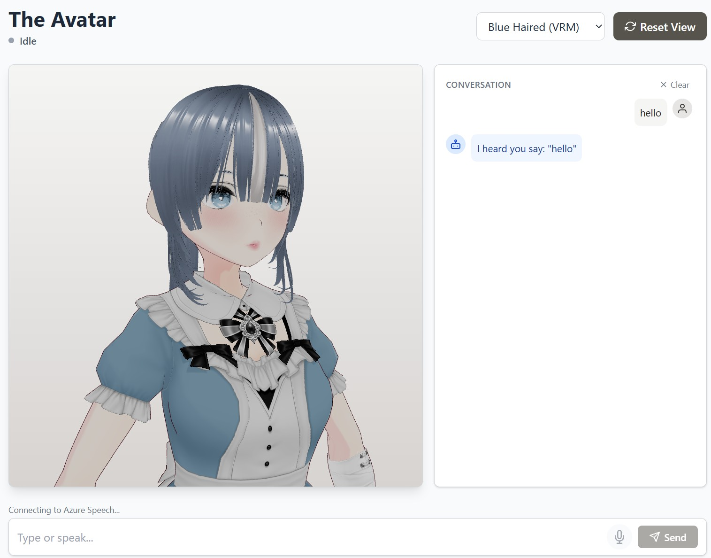

# react-talking-avatar

An interactive 3D talking avatar web app built with React, Three.js, and Azure Speech Services.
The avatar listens to your microphone, transcribes speech to text, generates a response, then speaks it aloud with
synchronized lip movement, head nodding, and idle body animations.

### Live Demo

Production: https://react-talking-avatar.zola8.workers.dev

Repository: https://github.com/zola8/react-talking-avatar

### Features

- VRM / GLB / FBX model support (VRM models get full animation, GLB/FBX are static)
- Azure Speech-to-Text (STT) — microphone input transcribed in real-time
- Mock LLM response (placeholder — real LLM integration is next)
- Azure Text-to-Speech (TTS) — multiple voices per model
- Lip sync — Azure viseme events drive VRM mouth expressions
- Head nodding — subtle nods while idle, stronger nods while speaking
- Idle body animations — breathing, body sway, eye blinking, arm relaxation
- Camera controls — orbit, zoom, pan; reset view button
- Conversation transcript — chat history with user/bot avatars, clear button
- Status pill — visual state indicator (idle / listening / thinking / speaking)
- Cancellable — stop button interrupts thinking/speaking
- Per-model config — voice, language, rotation, scale, vertical position

### Tech Stack

- Frontend: React 18 + TypeScript + Vite
- 3D: Three.js + @react-three/fiber + @react-three/drei
- VRM: @pixiv/three-vrm
- Speech: microsoft-cognitiveservices-speech-sdk (Azure)
- Styling: Tailwind CSS 4
- Hosting: Cloudflare Workers (Static Assets)
- Asset storage: Cloudflare R2



## Local Development

1. Install dependencies:

```shell
npm install
```

2. Create .env at the project root

```
AZURE_SPEECH_KEY=your-azure-speech-key-here
```

3. Start the dev server:

```shell
npm run dev
```

